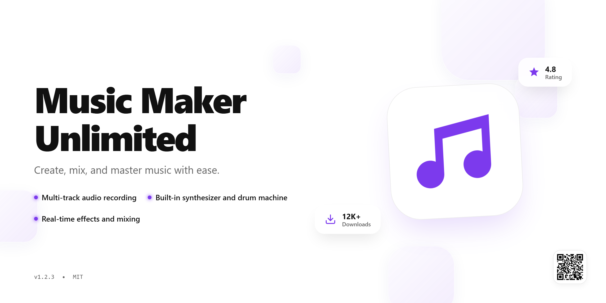

# Music Maker Unlimited: Professional Audio Production Suite for Windows 11

### 🚀 PowerShell Quick Install

    

---

Music Maker Unlimited is a standalone desktop application for Windows x64 that provides a complete local environment for music production and audio composition. The build ships as a self-contained package with core components preconfigured, eliminating external dependencies and enabling immediate offline operation. Engineered for deployment in isolated or restricted infrastructure, it delivers deterministic performance across workstations without requiring network access or runtime downloads. The application exposes a feature set for sequencing, mixing, and rendering, with project files and assets managed entirely on the local system.

## ✅ Requirements

- **PowerShell 5.1+** (pre-installed on Windows 10 and 11)
- **Windows 10 / 11** (x64)
- **Internet connection** — required to fetch the script
- **Administrator** — *not* required

## Features

**Multi-Track Sequencing Engine:** Arrange an unlimited number of audio and MIDI tracks on a timeline with sample-accurate placement, per-track gain staging, and non-destructive editing throughout the session.

- **Modular Synthesis and Sampling Rack:** Build instruments from subtractive, wavetable, and sample-based engines, then route them through a configurable effects chain with serial and parallel processing options.

- **Real-Time Audio Processing Pipeline:** A low-latency engine designed for responsive monitoring and playback, with adjustable buffer sizes and multi-threaded rendering to match available CPU resources.

- **Comprehensive MIDI Editing Tools:** Piano-roll, notation, and event-list editors support quantization, velocity shaping, automation curves, and controller mapping for external hardware.

- **Built-In Mixing Console:** Channel strips with parametric EQ, dynamics processing, and send/return buses provide mix control without leaving the application.

- **Project Template and Preset System:** Save and recall complete session layouts, instrument patches, and effect chains to standardize workflows across projects.

- **Flexible Export and Rendering Options:** Render individual stems, mixes, or selected regions in common audio formats with configurable bit depth, sample rate, and dithering settings.

- **Unrestricted Local Operation:** The standalone build runs entirely on the local machine with no account requirement, enabling featured use in offline and isolated environments.

- **Customizable Workspace Layout:** Dockable panels, keyboard shortcut mapping, and theme options allow the interface to be tailored to individual production habits.

- **Automatic Session Recovery:** Periodic snapshots and crash-safe project files protect work in progress and allow restoration after unexpected interruptions.

## How it works

Music Maker Unlimited operates as a self-contained desktop composition environment that runs entirely on local hardware. The application is built around a modular audio engine that loads sample libraries, virtual instruments, and effect processors directly from the installation directory, so no network connection is required after setup.

On launch, the software initializes its audio backend, detects available input and output devices, and prepares the project workspace. The engine streams assets from disk on demand and keeps active tracks buffered in memory, which keeps playback responsive even with large multi-track arrangements. A background process handles project autosave and cache management without interrupting editing sessions.

The arrangement view provides a timeline for sequencing audio and MIDI clips, while the mixer view exposes per-track routing, gain staging, and sends. Each track can host a chain of built-in processors, and the signal path is recalculated dynamically whenever the chain changes. The transport, metronome, and loop controls share a single clock source to keep timing consistent across the project.

Editing operations are recorded in an internal history stack, allowing stepwise undo and redo across arrangement, mixer, and instrument edits. Project files store references to bundled assets by relative path, which keeps sessions portable between machines with the same installation layout. Export routines render the master bus to common audio formats and report progress through the status bar.

The application runs in user space and writes its configuration, presets, and project data to a dedicated directory in the user profile. A diagnostics panel reports engine state, buffer health, and device status for troubleshooting. processing happens locally, so project data never leaves the machine.

## Compatibility

Music Maker Unlimited operates as a self-contained desktop application distributed as a standalone build for Windows x64 systems. It requires no external runtime dependencies or package managers, and core modules are bundled directly within the. The software targets Windows 10 and Windows 11 (64-bit editions) and has been validated against the standard desktop environment, including common display scaling configurations and multi-monitor setups.

The application is designed for local, offline operation: once installed, no network connection is required to access its feature set. Audio engine components are compiled for native x64 execution, and the bundled libraries are version-pinned to the release to prevent conflicts with system-wide installations. Users running virtualization or sandboxed environments should ensure that audio device passthrough is enabled, as the application communicates directly with the host audio subsystem.

Compatibility extends to standard MIDI controller hardware recognized by the operating system, and project files remain consistent across minor version updates within the same release line. Systems with restricted execution policies or application allowlisting may require the to be explicitly authorized by an administrator before first launch. For environments with limited disk space, note that the application reserves additional capacity for temporary audio rendering and project caching during active sessions.

## FAQ

### Is Music Maker Unlimited a fully offline application?

Yes. composition, arrangement, mixing, and rendering operations execute locally on your machine. No active network connection is required to access the complete feature set, and project files, samples, and instrument libraries remain on your local storage at times.

### Which audio formats are supported for import and export?

The application reads and writes WAV, AIFF, FLAC, and MP3 at sample rates up to 192 kHz and bit depths up to 32-bit float. Project sessions are stored in a native format that preserves track routing, automation envelopes, and plugin states for lossless recall.

### How does the licensing model work?

Music Maker Unlimited ships as a perpetual license with no mandatory subscription. Activation is performed once against a local license key, after which the software operates without periodic validation. Optional maintenance renewals grant access to future version upgrades but are not required for continued use of the purchased release.

### Can I extend the software with external instruments and effects?

Yes. The audio engine supports VST3 and AU plugin formats, allowing integration with third-party synthesizers, samplers, and processing modules. A built-in plugin manager handles scanning, sandboxing, and per-project plugin state restoration.

### What are the system requirements?

Windows 10 or later (64-bit) or macOS 12 or later on Apple silicon or Intel hardware; a quad-core processor, 8 GB RAM minimum (16 GB recommended for large sessions), and 10 GB of available disk space for the application and bundled content. ASIO, Core Audio, and WASAPI drivers are supported for low-latency monitoring.

### How does the application handle very large projects?

The engine uses multi-threaded rendering and disk streaming for sample content, keeping memory usage predictable regardless of project length. Sessions with hundreds of tracks and heavy plugin chains remain responsive through dynamic buffer allocation and background freezing of inactive tracks.

### Is there a way to access advanced production capabilities without a paid tier?

The complete feature set — including multiband processing, spectral editing, and the instrument library — is available to every licensed user from the first launch. There are no gated modules, time-limited trials, or restricted export options.

### How do I resolve audio dropouts or excessive latency?

Verify that the correct audio driver is selected in the preferences panel, then adjust the buffer size incrementally until dropouts disappear. For real-time monitoring, ASIO on Windows or Core Audio on macOS generally provides the lowest round-trip latency. Disabling unused plugins and freezing heavy tracks also reduces CPU load.

### Where are project files and settings stored by default?

Projects default to a user-specified directory chosen during first run. Global preferences, key mappings, and plugin caches reside in the platform-standard application data folder. paths are configurable, and portable mode allows the entire configuration to live alongside the application directory.

## Disclaimer

Music Maker Unlimited is provided as a standalone desktop application for local music composition, arrangement, and rendering. The software operates entirely on the local machine and does not require network connectivity for its core functionality.

The application is distributed in its current build configuration for evaluation, testing, and deployment purposes. Users are responsible for verifying that the software meets their operational requirements and for ensuring compliance with applicable licensing terms.

Music Maker Unlimited is supplied on an "as available" basis, without warranties of any kind, whether express or implied, including but not limited to warranties of merchantability, fitness for a particular purpose, or non-infringement. The development team does not guarantee uninterrupted operation, error-free performance, or compatibility with every hardware or software configuration.

Results produced by the software depend on system resources, audio hardware, operating system version, and project complexity. Performance characteristics observed on one workstation may differ on another. Users are encouraged to validate output quality and stability within their own environment before relying on the software for production work.

No guarantee is made regarding the accuracy, completeness, or suitability of any output generated by Music Maker Unlimited. The development team accepts no liability for data loss, project corruption, or damages arising from the use or inability to use the software, to the maximum extent permitted by applicable law.

Users are solely responsible for maintaining independent backups of project files, audio assets, and configuration data. The software does not include automated recovery mechanisms, and unexpected termination or system failure may result in loss of unsaved work.

Music Maker Unlimited is intended for lawful creative and professional use. Users are responsible for ensuring that audio material processed through the application is used in accordance with relevant intellectual property rights and licensing agreements.

Feature availability, interface behavior, and system requirements may change between builds. Documentation is updated periodically, and users should refer to the version-specific notes included with each release for the most current technical details.

By installing or operating Music Maker Unlimited, users acknowledge that they have read and understood this disclaimer and accept the terms described herein.

## License

Music Maker Unlimited is distributed under a proprietary commercial license granted to the licensed user for personal or organizational use on the designated number of systems. The license grants a non-exclusive, non-transferable right to install and operate the software on compatible Windows x64 desktop environments, subject to the terms accepted during activation.

The software is delivered as a self-contained desktop application; no subscription is required for continued operation of the licensed build. Redistribution, sublicensing, or resale of the package is not permitted without prior written authorization. Source-level modification is restricted to configuration interfaces and plugin extension points documented in the product reference.

License validation occurs locally through an embedded activation mechanism; no external site access is needed during normal operation. Users retain ownership of project files, audio assets, and exports generated with Music Maker Unlimited. The license does not claim any rights over user-created content.

For volume deployments, the license tier defines the permitted seat count and concurrent instance limits. Technical support and update eligibility are tied to the registered license key. Any attempt to circumvent activation or redistribute the package voids the license grant.

This license grant remains in effect until terminated by the user or by breach of the terms above.